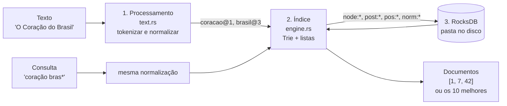
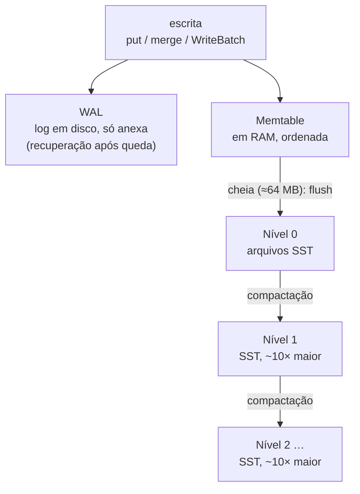
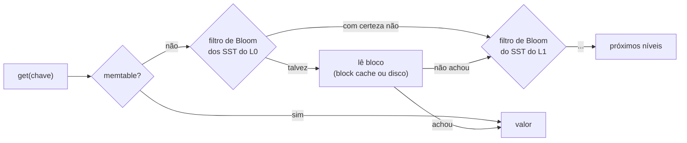
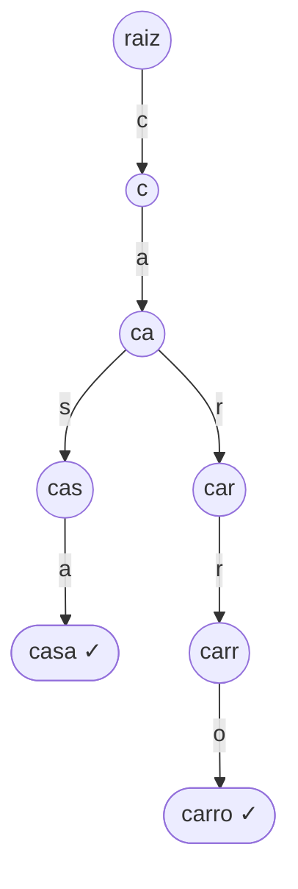
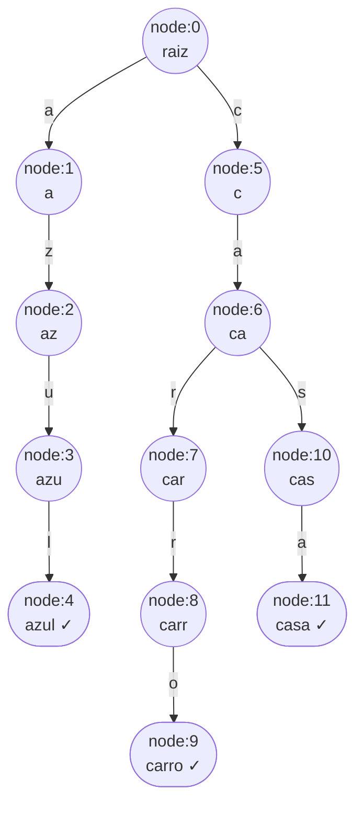
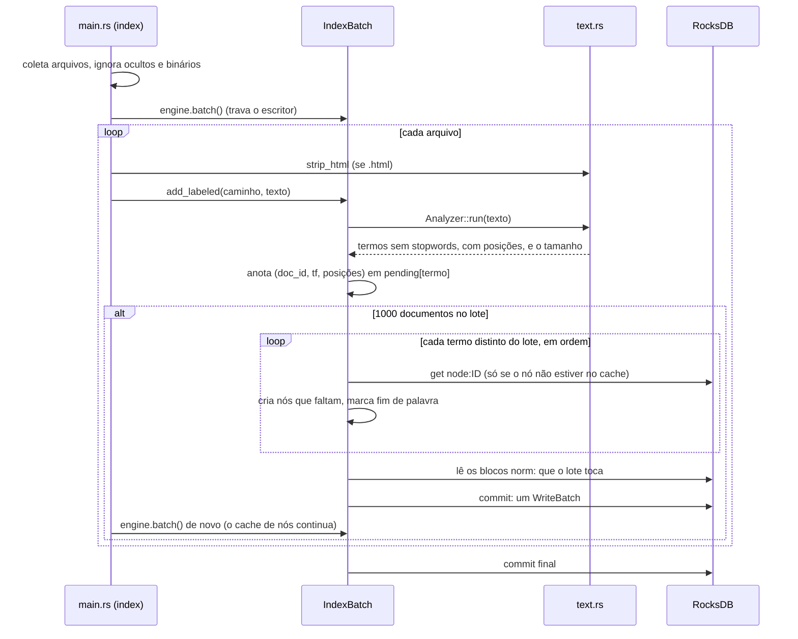
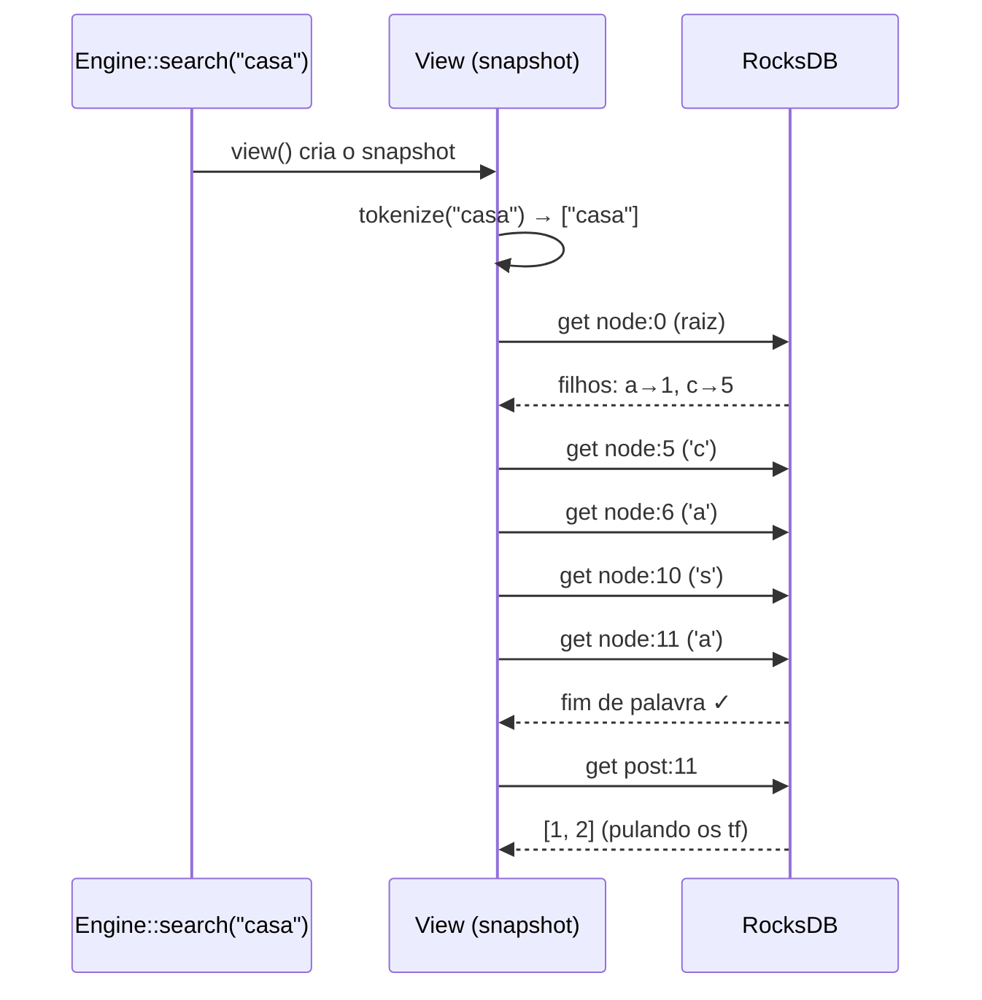
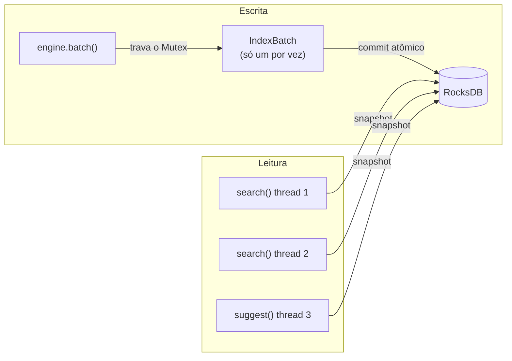
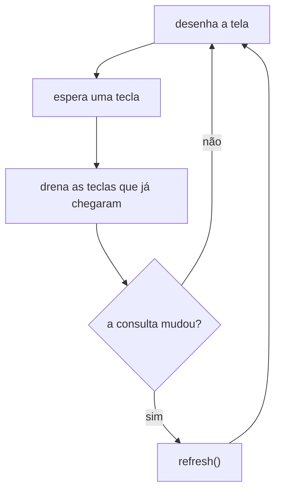

# Como o fire-flower funciona

Este documento explica o projeto de ponta a ponta: o que é o RocksDB, como os
dados ficam guardados nele e o caminho que um texto percorre até virar um
resultado de busca. Os exemplos usam dados reais, extraídos de um banco criado
pelo próprio motor.

**Sumário**

1. [A ideia em uma página](#1-a-ideia-em-uma-página)
2. [O que é o RocksDB](#2-o-que-é-o-rocksdb)
3. [Conceitos de busca: índice invertido e Trie](#3-conceitos-de-busca-índice-invertido-e-trie)
4. [Como os dados ficam no RocksDB](#4-como-os-dados-ficam-no-rocksdb)
5. [Fluxo de indexação](#5-fluxo-de-indexação)
6. [Fluxo de busca](#6-fluxo-de-busca)
7. [Concorrência: um escritor, muitos leitores](#7-concorrência-um-escritor-muitos-leitores)
8. [A CLI interativa](#8-a-cli-interativa)
9. [Mapa do código](#9-mapa-do-código)
10. [Custos e limites](#10-custos-e-limites)
11. [Glossário](#11-glossário)

---

## 1. A ideia em uma página

O fire-flower responde a perguntas como "quais documentos contêm a palavra
*coração* e alguma palavra começando com *bras*?" ou "onde aparece a frase
*revolução francesa*, dos mais relevantes para os menos?". Para responder
rápido, ele não lê os documentos na hora da busca. Ele monta antes um
**índice**: para cada palavra, a lista dos documentos onde ela aparece, quantas
vezes e em que posições.

As palavras ficam organizadas numa **Trie** (árvore de prefixos), e tanto a
árvore quanto as listas ficam gravadas no **RocksDB**, um banco chave-valor que
roda dentro do próprio programa. Não há servidor: o índice é uma pasta no
disco.



Três camadas, cada uma com uma responsabilidade:

| Camada | Onde | Faz |
|---|---|---|
| Processamento de texto | `src/text.rs` | transforma texto livre em termos padronizados |
| Índice | `src/engine.rs` | Trie, listas de documentos, busca, frases, ranking, autocompletar |
| Armazenamento | RocksDB + `src/codec.rs` | grava tudo em disco de forma durável e compacta |

---

## 2. O que é o RocksDB

### Em uma frase

O RocksDB é uma **biblioteca** (não um servidor) que guarda pares
**chave → valor** em disco, ordenados pela chave, e que é muito boa em
escrever rápido.

Foi criado pelo Facebook em 2012, a partir do LevelDB do Google, e hoje está
por baixo de sistemas como TiKV (o armazenamento do TiDB), MyRocks (MySQL) e
Kafka Streams. Para nós, ele é um
"`HashMap` que mora no disco, sobrevive a reinícios e não precisa caber na
RAM".

### O que ele oferece

| Operação | O que faz | Onde usamos |
|---|---|---|
| `put(chave, valor)` | grava ou sobrescreve | nós da Trie, rótulos, contadores |
| `get(chave)` | lê um valor | cada passo da travessia da Trie |
| `merge(chave, pedaço)` | anota um pedaço para combinar depois com o valor atual | listas de documentos |
| `WriteBatch` | agrupa várias escritas; ou entram todas, ou nenhuma | todo commit de indexação |
| `snapshot` | uma "foto" do banco num instante | toda busca |
| iterador | percorre as chaves em ordem | (ainda não usamos) |

Chaves e valores são **bytes** sem significado para o RocksDB. Dar estrutura a
eles (o que é um nó, o que é uma lista) é trabalho nosso.

### Como ele funciona por dentro (LSM-tree)

O RocksDB organiza os dados numa **LSM-tree** (*Log-Structured Merge tree*). A
ideia central é **nunca alterar um arquivo no lugar**: toda escrita vai para o
fim de algo, e a arrumação é feita depois, em segundo plano.



**Caminho da escrita:**

1. A escrita é anexada ao **WAL** (*write-ahead log*), um arquivo de log. Se
   o processo cair, o RocksDB relê o WAL ao abrir e não perde nada.
2. A escrita entra na **memtable**, uma estrutura ordenada em RAM.
3. Quando a memtable enche, ela vira um arquivo **SST** (*Sorted String
   Table*) no nível 0. Um SST é imutável: chaves ordenadas, divididas em
   blocos de ~4 KB, comprimidos (usamos LZ4).
4. Em segundo plano, a **compactação** junta SSTs de um nível com os do
   nível seguinte, descarta versões antigas e combina os `merge` pendentes.

Por isso escrever é barato: é só anexar ao log e inserir em RAM.

**Caminho da leitura (`get`):** o RocksDB procura do mais novo para o mais
velho e para no primeiro que tiver a chave.



Duas peças tornam esse caminho rápido, e as duas estão ligadas no nosso
`Engine::open`:

- **Filtro de Bloom.** Cada SST tem um resumo probabilístico das suas chaves
  que responde "com certeza não está aqui" ou "talvez esteja". Com 10 bits por
  chave, o "talvez" erra cerca de 1% das vezes. Na Trie isso importa: buscar
  uma palavra que não existe consulta chaves que não existem, e o filtro evita
  ler disco à toa.
- **Block cache.** Blocos lidos ficam em RAM (256 MB, política LRU). A raiz e
  os primeiros níveis da Trie são lidos por *toda* busca, então ficam sempre
  no cache e custam microssegundos.

Os filtros e os índices dos SSTs também moram no block cache, e aqui há uma
armadilha: o cache LRU se divide em até 64 partes (de pelo menos 512 KB), e um
bloco maior que uma parte **não fica no cache**. Por padrão o filtro de um SST
é um bloco só, do tamanho de 10 bits por chave. Na Wikipédia inteira, a
compactação gera SSTs de 64 MB só com chaves `node:` (pequenas e muitas), com
filtro de ~6 MB, maior que as partes de 4 MB de um cache de 256 MB. A partir
do momento em que o primeiro desses arquivos aparece, toda leitura que passa
por ele relê e redecodifica os 6 MB do filtro. Foi o que derrubava a carga de
~5.000 para ~200 artigos/s, em pontos diferentes a cada rodada (depende de
quando a compactação gera o arquivo). Por isso o `Engine::open` usa filtros e
índices **particionados**: blocos de 4 KB, mais um índice de topo pequeno
fixado no cache. O teste `bloom_filters_larger_than_a_cache_shard_...`
reproduz o problema em escala pequena, e `perf.py carga-longa` o vigia na
carga inteira.

### Três recursos que o projeto usa de forma especial

**WriteBatch (atomicidade).** Um commit de indexação grava centenas de nós e
listas. Se só metade entrasse, a Trie poderia apontar para um nó que não
existe. O `WriteBatch` vai para o WAL como um único registro: ou entra tudo, ou
nada.

**Merge operator (anexar sem ler).** A lista de documentos de "de" pode ter um
milhão de IDs. Sem merge, adicionar um documento exigiria ler a lista inteira,
acrescentar um ID e regravá-la. Com merge, gravamos só o pedaço novo
(`merge("post:1", [42])`) e registramos uma função que sabe unir pedaços (a
`merge_postings`). O RocksDB chama essa função quando alguém lê a chave e
durante a compactação, quando consolida os pedaços de vez.

**Snapshot (consistência de leitura).** Toda escrita recebe um número de
sequência crescente. Um snapshot "congela" um número: leituras feitas por ele
ignoram tudo que foi escrito depois. Uma busca faz dezenas de `get`s; com o
snapshot, todas enxergam o mesmo momento do índice, mesmo que um commit
aconteça no meio.

### Um detalhe que surpreende: a ordem das chaves

O RocksDB ordena as chaves **byte a byte**, como texto. Por isso `node:10`
vem antes de `node:2` (o caractere `1` é menor que `2`). Para nós isso não
importa, porque sempre acessamos os nós por chave exata. Mas é o que você vê ao
listar o banco (seção 4).

---

## 3. Conceitos de busca: índice invertido e Trie

### Índice invertido

Um documento "normal" vai de documento → palavras. O índice **inverte** isso:
palavra → documentos.

| Termo | Lista de postagem (IDs de documentos) |
|---|---|
| `azul` | 1, 2 |
| `carro` | 2 |
| `casa` | 1, 2 |

Buscar `casa carro` é pegar as duas listas e calcular a interseção: `[2]`.
A lista de documentos de um termo se chama **lista de postagem** (*postings
list*).

### Trie (árvore de prefixos)

Precisamos encontrar o termo `casa` para chegar à lista dele. Uma Trie guarda
as palavras caractere a caractere, e palavras com o mesmo começo
compartilham o mesmo caminho:



O ✓ marca "fim de palavra": `cas` é só um caminho, `casa` é um termo indexado.

A vantagem sobre um simples dicionário de palavras é o **prefixo**: para
autocompletar `ca`, basta descer até o nó `ca` e listar tudo que está abaixo
dele. É isso que alimenta o `suggest` e as buscas `termo*`.

---

## 4. Como os dados ficam no RocksDB

### Os espaços de chave

Como o RocksDB só conhece chave → valor, separamos os tipos de dado por um
prefixo na chave:

| Chave | Valor | Exemplo |
|---|---|---|
| `node:<id>` | um nó da Trie: "é fim de palavra?" + filhos (`caractere → id`) | `node:0` é sempre a raiz |
| `post:<id>` | lista de postagem do termo que **termina** no nó `<id>`: cada documento e quantas vezes o termo aparece nele (tf) | `post:11` = documentos com `casa` |
| `pos:<id>` | as posições do termo em cada documento (só em bancos com posições) | `pos:11` = onde `casa` aparece |
| `norm:<bloco>` | o tamanho de cada documento cujo `id ÷ 1024` é o bloco | `norm:0` = documentos 0 a 1023 |
| `doc:<id>` | rótulo do documento (a CLI grava o caminho do arquivo) | `doc:42` → `/home/.../notas.txt` |
| `meta:next_node_id` | próximo ID livre para nós | |
| `meta:next_doc_id` | próximo ID livre para documentos | |
| `meta:doc_count`, `meta:total_len` | total de documentos e soma dos tamanhos (para o ranking) | |
| `meta:format`, `meta:positions`, `meta:languages` | versão do formato (2), se grava posições e idiomas das stopwords | |

A lista de postagem usa o mesmo número do nó onde a palavra termina. Assim
não precisamos de um segundo contador nem de guardar o ID da lista dentro do
nó. As posições ficam numa chave à parte (`pos:`) porque são de 2 a 3 vezes
maiores que a lista: uma busca sem frase nunca as lê (o Lucene separa os
arquivos `.doc` e `.pos` pelo mesmo motivo).

### Um banco real, byte a byte

Indexando dois documentos (com as stopwords padrão, português e inglês):

```text
documento 1: "A casa azul"
documento 2: "O carro azul e a Casa"
```

O banco resultante tem exatamente estas chaves (valores em hexadecimal, na
ordem em que o RocksDB as guarda):

```text
meta:doc_count         02
meta:format            02
meta:languages         pt,en
meta:next_doc_id       03
meta:next_node_id      0c
meta:positions         01
meta:total_len         05
node:0                 00 02 61 01 63 05
node:1                 00 01 7a 02
node:10                00 01 61 0b
node:11                01 00
node:2                 00 01 75 03
node:3                 00 01 6c 04
node:4                 01 00
node:5                 00 01 61 06
node:6                 00 02 72 07 73 0a
node:7                 00 01 72 08
node:8                 00 01 6f 09
node:9                 01 00
norm:0                 02 01 02 01 03
pos:11                 02 01 01 01 01 01 05
pos:4                  02 01 01 02 01 01 02
pos:9                  01 02 01 01
post:11                02 01 01 01 01
post:4                 02 01 01 01 01
post:9                 01 02 01
```

"a", "o" e "e" são stopwords: não entram no índice. A Trie que esses bytes
descrevem tem só `azul`, `carro` e `casa`:



Repare:

- `Casa` e `casa` viraram o mesmo termo (normalização, seção 5.1).
- `a` não é palavra (é stopword), mas o nó `a` existe como começo de `azul`.
- `casa` e `carro` compartilham os nós `c` e `ca`.

### Lendo um nó: `node:6`

```text
00          flags: 0 = não é fim de palavra
02          2 filhos
72 07       'r' (0x72) → node:7
73 0a       's' (0x73) → node:10
```

Os filhos ficam em ordem de caractere (é um `BTreeMap`), o que deixa o
autocompletar em ordem alfabética sem esforço extra.

### Lendo uma lista: `post:11` (o termo `casa`)

```text
02          2 documentos
01 01       documento 0 + 1 = 1, tf 1
01 01       documento 1 + 1 = 2, tf 1
```

### Lendo as posições: `pos:11`

```text
02          2 documentos
01 01 01    documento 1: 1 posição, a 1 ("A casa azul": a@0 casa@1 azul@2)
01 01 05    documento 2: 1 posição, a 5 ("O carro azul e a Casa": casa@5)
```

As posições contam **todas** as palavras, stopwords inclusive. Por isso
`casa` está na posição 5 do documento 2, e a frase `"azul e a casa"` pode ser
conferida: `azul` em 2 e `casa` em 2 + 3.

### Lendo os tamanhos: `norm:0`

```text
02          2 documentos neste bloco (IDs 0 a 1023)
01 02       deslocamento 0 + 1 = 1 (documento 1), tamanho 2 (casa, azul)
01 03       deslocamento 1 + 1 = 2 (documento 2), tamanho 3 (carro, azul, casa)
```

O tamanho conta só os tokens indexados (sem stopwords). `meta:total_len = 5`
é a soma dos tamanhos e `meta:doc_count = 2`; o ranking usa o tamanho médio
(5 ÷ 2) para comparar documentos.

Duas técnicas deixam tudo isso pequeno:

- **Varint:** um número ocupa só os bytes de que precisa. Cada byte carrega 7
  bits do número; o bit mais alto diz "tem mais um byte". `1` ocupa 1 byte,
  `300` ocupa 2 (`ac 02`), e o máximo de 64 bits ocupa 10.
- **Deltas:** a lista é ordenada, então guardamos a *diferença* para o ID
  anterior. `[1000, 1001, 1005]` vira `1000, 1, 4`: 2 + 1 + 1 bytes em vez de
  24. Por isso IDs próximos uns dos outros deixam o índice menor. As posições
  de um documento também são deltas (a primeira é absoluta).

Os contadores também usam varint: `meta:next_node_id = 0c` significa 12 (os
nós 0 a 11 existem).

---

## 5. Fluxo de indexação

Visão geral do que acontece em `fire-flower index <banco> <pasta>`:



### 5.1 Processamento de texto (`text::for_each_token`)

O objetivo é que `Ação`, `ACAO` e `acao` virem o mesmo termo. Para cada
caractere:

1. **Decomposição NFKD.** Caracteres acentuados viram letra-base + acento
   separado: `ç` → `c` + `◌̧`, `ã` → `a` + `◌̃`. A forma "K" também desfaz
   variantes tipográficas: a ligadura `fi` vira `fi`, e o `１` de largura total
   vira `1`.
2. **Descarta os acentos soltos** (marcas combinantes).
3. **Letras e dígitos** (de qualquer alfabeto) entram no termo atual, em
   minúsculas.
4. **Qualquer outra coisa** (espaço, pontuação, `-`, `_`) encerra o termo.
5. Termos com mais de 64 caracteres são descartados (hashes, base64, lixo)
   para não criar caminhos enormes e inúteis na Trie.

```text
"Ação, CORAÇÃO! São-Paulo e-mail"
 → acao@0, coracao@1, sao@2, paulo@3, e@4, mail@5
```

Cada token sai com a sua **posição**: o número dele no texto, contando todo
token entregue (stopwords inclusive; os descartados por tamanho não contam).
A busca por frase precisa disso.

O caminho comum é rápido: caracteres ASCII (a maior parte do português) não
passam pelas tabelas Unicode, e nenhum token vira `String`: `for_each_token`
entrega um `&str` de um buffer reaproveitado. Fazer a decomposição NFKD
caractere a caractere, em vez da string inteira, só mudaria a ordem das
marcas combinantes, que são descartadas; um teste confere isso para todos os
caracteres Unicode.

Para HTML, `strip_html` roda antes: remove as tags (cada tag vira um espaço,
senão `<p>a</p><p>b</p>` viraria `ab`), descarta `<script>`/`<style>`
inteiros e decodifica entidades comuns (`&amp;`, `&nbsp;`…).

A **mesma** função é usada na busca. Se as duas normalizações divergissem, os
termos buscados nunca bateriam com os indexados.

**Stopwords.** Depois de normalizar, a indexação descarta as palavras
comuns dos idiomas do banco. As listas ficam em `src/stopwords/pt.txt` e
`en.txt` (baseadas no Snowball/NLTK), uma palavra por linha e embutidas no
binário; `src/stopwords.rs` as normaliza num `FxHashSet`, consultado uma vez
por token.

Os idiomas são escolhidos na criação (`Config::languages`, ou `--idiomas` na
CLI; o padrão é português e inglês) e gravados em `meta:languages`. Abrir o
banco depois usa o que está gravado; pedir outros idiomas é erro, porque
índice e consulta precisam descartar as mesmas palavras. Para um idioma
novo: um arquivo em `src/stopwords/` e uma variante em `Language`. Elas aparecem em quase todo documento, então só inchariam o
índice: na Wikipédia, "de" está em 99% dos artigos. Na busca, `parse_query`
descarta as mesmas palavras quando exatas, senão `casa de papel` exigiria um
termo que não existe e voltaria vazia. Como prefixo (`de*`) elas continuam
valendo. "são" e "era" ficam fora da lista de propósito: são também nomes
(São Paulo, Era Vargas).

### 5.2 Lote invertido

`add_document` não toca na Trie. O `text::Analyzer` agrupa os tokens do
documento por termo (um mapa `&str → grupo` e uma ordenação por contagem das
posições, reaproveitando os buffers entre documentos) e devolve o tamanho do
documento: quantos tokens sobraram sem as stopwords. Um documento que diz
"café" dez vezes entra uma vez só na lista de `cafe`, com tf = 10 e as dez
posições. O lote anota `(doc_id, tf)` e as posições em `pending[termo]`, e o
tamanho numa lista à parte. No commit, cada termo distinto do lote é inserido
na Trie **uma vez**, em ordem alfabética. Num lote de 1.000 artigos, "brasil"
aparece em centenas deles, mas a Trie é percorrida uma vez só para ele.

**Reindexar o mesmo ID** troca o tf, as posições e o tamanho dele: dentro do
lote, a última adição vence; entre lotes, quem decide é o merge operator
(5.5). O total de documentos não conta o ID duas vezes. Termos que saíram do
texto continuam apontando para o documento (não há remoção).

A ordem alfabética deixa a criação de nós determinística: o mesmo corpus com
o mesmo tamanho de lote gera sempre os mesmos IDs. Com outro tamanho de lote
os IDs mudam, mas o conteúdo (termo → documentos) é o mesmo.

### 5.3 Inserção na Trie (`IndexBatch::insert_term`)

Para o termo `carro`, começando em `node:0`:

1. Pega o nó atual com `node_mut`. Se ele já está no cache (lido ou criado
   antes, neste lote ou num anterior), usa a cópia em memória; senão, lê do
   RocksDB e decodifica.
2. Procura o próximo caractere nos filhos.
   - **Existe:** desce para o filho.
   - **Não existe:** reserva o próximo ID (`next_node_id`), cria um nó vazio,
     registra o filho no pai e marca os dois como modificados (*dirty*).
3. No último caractere, marca `is_end_of_word = true`.
4. Grava a lista do termo em `post:<id do nó final>` e as posições em
   `pos:<id do nó final>`.

**Por que o lote guarda nós em memória?** Nada é gravado antes do commit. Se o
lote tem `carro` e `carta`, a inserção de `carta` precisa enxergar os nós
`c`, `ca`, `car` que `carro` acabou de criar, e eles ainda não existem no
banco. O mapa `nodes` do lote é essa visão "banco + mudanças pendentes".

**Cache entre lotes.** Depois do commit, os nós em memória são iguais aos do
banco, e só o escritor altera a Trie. Então o mapa volta para o `WriterState`
e o próximo lote começa com ele: a raiz e os nós dos termos comuns não são
relidos a cada commit. Um lote descartado (ou com commit que falhou) leva o
cache junto, e o próximo começa do banco. O cache tem um teto
(`Config::writer_cache_nodes`, 1 milhão de nós, ~200 MB): passando dele, saem
primeiro os nós que o último lote não usou e depois os mais fundos.

### 5.4 Commit (`IndexBatch::commit`)

Um único `WriteBatch` com:

| O quê | Operação | Observação |
|---|---|---|
| cada nó *dirty* | `put node:<id>` | nós só lidos não são regravados |
| cada lista nova | `merge post:<id>` | só os documentos novos, com tf, ordenados e em deltas |
| cada lista de posições | `merge pos:<id>` | só com posições ligadas |
| cada bloco de tamanhos tocado | `put norm:<bloco>` | o bloco inteiro: lido, atualizado e regravado |
| cada rótulo | `put doc:<id>` | |
| contadores e estatísticas | `put meta:*` | `doc_count` e `total_len` incluídos |

Os blocos de `norm:` são lidos no commit (com IDs crescentes, um ou dois por
lote) para saber se o documento já existia: se sim, troca o tamanho e ajusta
`total_len`; se não, conta mais um em `doc_count`. Tudo vai no mesmo
`WriteBatch`, então lista, posições, tamanhos e estatísticas nunca
discordam.

O `db.write(batch)` é atômico. Só depois dele os contadores em memória
(`WriterState`) avançam. Se o lote for descartado sem commit, ou o commit
falhar, nada muda: nem o banco, nem os contadores.

A CLI faz commit a cada 1.000 documentos para limitar a memória: o lote guarda
os termos de todos os documentos até o commit.

### 5.5 O que o RocksDB faz depois

O `WriteBatch` vai para o WAL e para a memtable. Mais tarde, em segundo plano:

- a memtable vira SST (*flush*);
- a compactação chama o merge operator para unir os pedaços de cada lista
  (`[1, 2]` + `[5]` + `[9]` → `[1, 2, 5, 9]`) e grava a lista já consolidada.

O merge une **por documento**: se dois pedaços trazem o mesmo documento, o
mais novo vence (é assim que reindexar troca o tf e as posições). Essa regra é
associativa, então o RocksDB pode juntar pedaços consecutivos em qualquer
agrupamento; um teste confere isso com pedaços aleatórios. O caso comum, uma
carga com IDs crescentes, tem um atalho: cada pedaço começa depois do fim do
anterior, e o merge só concatena os bytes, refazendo um delta por pedaço, sem
decodificar as listas. Pedaços que se sobrepõem passam pelo caminho completo
(decodifica, ordena de forma estável, fica com o último de cada documento).

Enquanto a compactação não roda, uma leitura de `post:<id>` une os pedaços na
hora. Por isso listas muito disputadas podem ficar mais lentas logo depois de
uma carga grande; o plano de performance mede isso.

---

## 6. Fluxo de busca

### 6.1 Termo exato: `casa`



Custo: **1 `get` por caractere + 2** (raiz e lista), menos os níveis que já
estão no **cache de nós das buscas**: a raiz e os nós até a profundidade 2
(`Config::reader_cache_depth`) ficam decodificados em memória, compartilhados
por todas as buscas (seção 7). A raiz tem um filho por caractere inicial e
cresce com o índice: 13 KB com 100 mil artigos da Wikipédia. Sem o cache, toda
busca a decodificava inteira, e isso era quase todo o tempo de uma busca
simples (116 µs de 120 µs num termo inexistente; com o cache, 5 µs).

Se algum caractere não
existir nos filhos, a busca termina ali com zero resultados. Se o caminho
existir mas o nó final não for fim de palavra (`cas`), também dá zero:
prefixo de palavra não é palavra.

### 6.2 Vários termos: `casa carro`

1. Busca a lista de cada termo, como acima.
2. **Lista vazia em qualquer termo:** retorna vazio na hora, sem buscar os
   outros.
3. Ordena as listas da menor para a maior e faz a interseção nessa ordem. A
   interseção de duas listas ordenadas anda com dois ponteiros, em tempo
   linear. Começar pela menor faz o resultado parcial já nascer pequeno.

```text
casa  → [1, 2]
carro → [2]
interseção → [2]
```

Uma palavra com hífen vira vários termos, como na indexação: `e-mail` busca
`e` **e** `mail`.

### 6.3 Prefixo: `ca*`

1. Desce até o nó `ca` (`node:6`).
2. Faz uma busca em largura a partir dele e coleta os nós com ✓: `casa`,
   `carro`. Para no máximo em `max_prefix_terms` (256) termos.
3. Une as listas de todos esses termos (ordena e remove repetidos).
4. O resultado entra na interseção como se fosse a lista de um termo comum.

**Atenção:** prefixos muito curtos (`a*` na Wikipédia) casam milhares de
termos, e os que passam de 256 são ignorados. O resultado fica incompleto, sem
aviso. É um limite conhecido.

### 6.4 Autocompletar: `suggest("ca", 10)`

Mesma busca em largura do prefixo, devolvendo as palavras em vez das listas.
A busca em largura visita primeiro os nós mais rasos, e os filhos estão em
ordem alfabética. Por isso as sugestões saem **das mais curtas para as mais
longas e, no mesmo comprimento, em ordem alfabética**: para `ca`, `casa` (4
letras) vem antes de `carro` (5).

As sugestões vêm **normalizadas** (`coracao`, não `coração`), porque é assim
que os termos estão na Trie.

### 6.5 Frase: `"azul e a casa"`

`parse_query` transforma o texto entre aspas numa lista de termos com a
distância de cada um até o primeiro. As stopwords somem, mas a distância
fica: `"azul e a casa"` vira `azul@0, casa@3`. Uma frase de um termo só
(`"casa"`) é um termo comum, e uma frase só de stopwords some.

1. Os termos da frase entram no E como termos comuns, pelas listas `post:`
   (rápidas): `azul` → [1, 2], `casa` → [1, 2].
2. Só nos documentos que sobraram (de todas as partes da consulta), confere
   as posições em `pos:`. Um cursor por termo anda pela lista e **pula** as
   posições dos documentos que não interessam sem decodificá-las.
3. O documento fica se existe *p* com `azul` em *p* e `casa` em *p* + 3. No
   documento 2, `azul` está em 2 e `casa` em 5: casa. No documento 1, `azul`
   está em 2 e `casa` em 1: não.

Num banco criado sem posições (`--sem-posicoes`), uma frase dá erro de
configuração em vez de um resultado errado.

**Limitações:** a stopword só conta a distância (`"casa de papel"` também casa
"casa da papel"; o Lucene com filtro de stopwords faz o mesmo), e não há
prefixo dentro de frase.

### 6.6 Ranking: `search_top("casa azul", 10)`

`search` devolve todos os IDs em ordem. `search_top` (e `search_ranked`, que
também dá o total) devolve os *k* mais relevantes pelo **BM25**:

```text
idf(t)     = ln(1 + (N − df + 0,5) / (df + 0,5))
nota(t, d) = idf(t) · tf · (k1 + 1) / (tf + k1 · (1 − b + b · |d| / média))
nota(d)    = soma das notas das partes da consulta
```

*N* é `meta:doc_count`, *df* o tamanho da lista do termo, *|d|* o tamanho do
documento (`norm:`) e a média é `total_len ÷ N`. `k1 = 1,2` e `b = 0,75`
(`Config::bm25_k1`, `Config::bm25_b`). Um termo raro (idf alto) pesa mais; o
tf ajuda, mas satura; e o mesmo tf vale mais num documento curto.

- **Prefixo:** conta como **um termo só**. O df é o número de documentos com
  alguma completação, e o tf de um documento é a soma dos tf das completações
  que ele contém. Assim uma completação rara não vale mais que a palavra que
  se está digitando: com a regra antiga (a nota da melhor completação, cada
  uma com o próprio idf), `coreia norte*` punha em 1º um artigo que cita a
  Nortel ([plano-relevancia.md](plano-relevancia.md), R1).
- **Frase:** entra na soma como um termo, com tf = quantas vezes a frase
  aparece no documento e idf = soma dos idfs dos termos (como o Lucene).
- **Empate:** nota decrescente, depois ID crescente.

O E é o mesmo da busca sem ranking: a lista menor conduz e as outras avançam
por saltos (busca exponencial) até o documento dela. Para cada documento que
casa, a nota é somada na ordem da consulta e entra num heap dos *k* melhores.

Para não pagar a nota de todo documento:

- **Limite superior.** A maior nota que uma parte pode dar com um certo tf é a
  de um documento de tamanho 0. Isso fica numa tabela por tf, sem divisão. Com
  o heap cheio, um documento cujo limite não passa do pior guardado é pulado
  sem ler o tamanho. O corte é exato: ponto flutuante arredonda de forma
  monótona, então o limite nunca fica abaixo da nota de verdade.
- **Termo único** (o caso mais comum): a nota só depende do tf e do tamanho.
  Os documentos são agrupados em níveis de tf, e o limite de um nível vale
  para todos os abaixo dele. Uma passada conta os documentos de cada nível;
  a primeira faixa (do maior tf até juntar *k* documentos) enche o top; a
  segunda vai até o primeiro nível cujo limite não alcança o pior guardado, e
  ali a busca para. Cada faixa é uma passada sequencial em ordem de ID, sem
  reordenar a lista. Num termo frequente da Wikipédia de 100k (~25 mil
  documentos), só ~11% recebem nota; o resto (tf baixo) nem lê o tamanho.
- **Tamanhos em cache.** Os blocos de `norm:` decodificados ficam num cache do
  `Engine`, compartilhado pelas buscas (seção 7). Em memória o bloco é denso
  (um número por ID, até 4 KB), então ler o tamanho de um documento é um
  acesso direto.

Na Wikipédia de 100k (cache quente, 1 thread), o top 10 de um termo frequente
leva ~200 µs, e devolver todos os IDs do mesmo termo, ~45 µs. A maior parte
da diferença é decodificar a lista com tf e passar por ela de novo: para ir
além, é preciso não decodificar a lista inteira (ver "Possíveis evoluções").

---

## 7. Concorrência: um escritor, muitos leitores

`Engine` pode ser compartilhado entre threads (`Arc<Engine>`).



- **Escrita:** `engine.batch()` pega um `Mutex`. Um segundo `batch()` espera
  o primeiro terminar, inclusive na mesma thread: abrir um lote com outro
  aberto trava o programa.
- **Leitura:** buscas não pegam trava nenhuma. Cada uma cria um snapshot e lê
  por ele.
- **Por que nunca se vê um lote pela metade:** o commit é um único
  `WriteBatch`, e a busca lê de um único snapshot. Ou o snapshot é anterior
  ao commit (não vê nada do lote), ou é posterior (vê tudo).
- **Por que um nó nunca aponta para o vazio:** nós só ganham filhos, nunca os
  perdem, e um nó novo é gravado no mesmo `WriteBatch` que o pai que aponta
  para ele.
- **Os caches das buscas respeitam o snapshot.** Os blocos `norm:` e os nós
  rasos da Trie ficam num cache compartilhado (`EpochCache`), mas uma busca
  não pode usar um valor gravado depois do snapshot dela. Cada commit tem um número (*epoch*). Antes de gravar, o
  escritor marca os blocos e os nós rasos que vai mudar com o número do
  próximo commit;
  depois de gravar, publica o número. A busca lê o número **antes** de criar o
  snapshot e só usa um bloco do cache se ele não for mais novo que ela; senão
  lê do próprio snapshot e não guarda nada. Um teste roda buscas ranqueadas
  enquanto outro thread reindexa documentos do mesmo bloco.

---

## 8. A CLI interativa

`fire-flower tui <banco>` (código em `src/tui.rs`, interface feita com
[ratatui](https://ratatui.rs)).

```text
 ✿ fire-flower   /tmp/db                              1 resultado  ·  149.25µs
╭ Busca ───────────────────────────────────────────────────────────────────────╮
│› coração bravo                                                               │
╰──────────────────────────────────────────────────────────────────────────────╯
 consulta: coração bra*
╭ Sugestões ─────────────╮╭ Resultados ────────────────────────────────────────╮
│▸ bravo                 ││▸   1 /tmp/brasil.txt                               │
│  brasil                ││                                                    │
│  brasilia              ││                                                    │
╰────────────────────────╯╰────────────────────────────────────────────────────╯
╭ Prévia ──────────────────────────────────────────────────────────────────────╮
│ 2 │ O coração do Brasil bate forte.                                          │
│ 3 │ Brasília é a capital.                                                    │
╰──────────────────────────────────────────────────────────────────────────────╯
 Tab completar   ^N/^P trocar sugestão   ↑↓ resultado   Enter abrir   Esc sair
```

O laço de eventos:



O que o `refresh()` faz a cada mudança:

1. **Palavra atual:** se a consulta não termina em espaço, a última palavra
   ainda está sendo digitada.
2. **Consulta efetiva:** essa palavra ganha um `*`. Digitar `coração bra`
   busca `coração bra*`, e os resultados aparecem antes de a palavra
   terminar. A consulta efetiva aparece sob a caixa de busca.
3. **Sugestões:** `suggest(palavra atual, 8)`. A selecionada aparece em cinza
   depois do cursor; `Tab` troca a palavra por ela e adiciona um espaço.
4. **Busca:** `search_ranked(consulta efetiva, 1000)`, cronometrada para o
   cabeçalho, que mostra o total. A lista mostra a nota ao lado de cada
   resultado. Dentro de aspas abertas a palavra atual não ganha `*` (frase
   não tem prefixo), e a linha "consulta:" mostra a frase como uma unidade:
   `"copa _ mundo"`.

Detalhes que mantêm a interface rápida:

- **Drenar teclas:** quem digita rápido ou cola um texto dispara uma busca só,
  não uma por tecla.
- **Top 1.000:** com um milhão de resultados, só os mil melhores são
  ranqueados por inteiro; e só os rótulos das linhas visíveis são lidos do
  banco (e guardados num cache).
- **Prévia:** lê o arquivo do rótulo (até 2 MB) e destaca as palavras que
  casam com a consulta, usando a mesma normalização. Documentos cujo rótulo
  não é um arquivo, como os artigos da Wikipédia que guardarão o título,
  ficam sem prévia.

---

## 9. Mapa do código

| Arquivo | Peças principais |
|---|---|
| `src/lib.rs` | API pública: `Engine`, `Config`, `IndexBatch`, `Error`, `DocId` |
| `src/text.rs` | `for_each_token` (tokens com posição), `tokenize`, `Analyzer` (termos com posições e tamanho), `parse_query` (termos, prefixos e frases), `normalize_term`, `strip_html` |
| `src/stopwords.rs`, `src/stopwords/*.txt` | idiomas (`Language`) e listas de stopwords |
| `src/codec.rs` | `TrieNode`, listas `post:` (`decode_postings`, `decode_docs`), posições `pos:` (`PositionsCursor`), blocos `norm:` (`NormBlock`), merge por documento (`merge_postings`, `merge_positions`), varint |
| `src/engine.rs` | `Engine::open` (opções do RocksDB, formato), `batch`, `search`, `search_top`/`search_ranked`, `suggest`, `label`; `View` (leituras sobre snapshot, frases, BM25 e top-k); `NormCache` (tamanhos compartilhados); `IndexBatch` (`add_document`, `insert_term`, `node_mut`, `commit`); `merge_operator`, `intersect` |
| `src/main.rs` | subcomandos `tui`, `index`, `search`, `suggest` |
| `src/tui.rs` | a CLI interativa |
| `tests/engine.rs` | testes de ponta a ponta: persistência, lotes descartados, concorrência… |

API mínima:

```rust
use fire_flower::{Config, Engine};

let engine = Engine::open("/tmp/indice", Config::default())?;

let mut batch = engine.batch();
batch.add_document(1, "O coração do Brasil")?;
batch.commit()?;

engine.search("coração bras*")?;   // Vec<DocId>
engine.search("\"coração do brasil\"")?; // frase
engine.search_top("coração", 10)?; // Vec<Hit { doc, score }>, BM25
engine.suggest("cor", 10)?;        // Vec<String>
```

---

## 10. Custos e limites

| Operação | Custo | Observação |
|---|---|---|
| Buscar termo de *L* letras | *L* − 2 `get`s (*L* ≥ 3) + 1 da lista | os 3 primeiros níveis da Trie vêm do cache de nós |
| Termo inexistente | até *L* − 2 `get`s | para no primeiro caractere que falta |
| AND de *n* termos | *n* buscas + interseções | retorna cedo se algum termo não existe |
| Prefixo | 1 `get` por nó visitado + 1 por lista | limitado a 256 termos |
| Frase de *n* termos | as *n* listas `post:` + *n* listas `pos:` | posições só conferidas nos documentos que passaram no E |
| Top *k* (BM25) | o E + 2 `get`s (estatísticas) + tamanho dos documentos que podem entrar no top | blocos de `norm:` em cache |
| Indexar um lote | tokenizar + 1 caminho na Trie por termo distinto do lote + os blocos de `norm:` tocados | nós no cache do escritor não são relidos |
| Commit | 1 `WriteBatch` | escrita sequencial no WAL |

**Espaço:** as posições são a maior parte do banco. Na fatia de 10k da
Wikipédia, os valores de `pos:` somam 26 MB, os de `post:` (com tf) 11 MB e a
Trie ~12 MB. Compactado, o banco tem ~51 MB com posições e ~21 MB sem (o
formato v1, sem tf nem tamanhos, tinha ~17 MB).

**Ainda não existe:**

- remover documentos (reindexar o mesmo ID troca tf, posições e tamanho, mas
  termos que saíram do texto continuam apontando para ele);
- campos com pesos diferentes (o título pesando mais que o texto, BM25F);
- OU, prefixo dentro de frase, proximidade (`NEAR`) e stemming ("casa" ≠ "casas");
- `fsync` a cada commit: se o *sistema operacional* cair (não só o processo),
  os últimos commits podem se perder. O padrão do RocksDB é não sincronizar a
  cada escrita.

**Possíveis evoluções** (a medir antes, ver
[plano-performance.md](plano-performance.md)):

- um índice ordenado `term:<palavra>` com o iterador do RocksDB faria a busca
  exata em 1 `get` e o prefixo num único scan;
- blocos com índice de saltos nas listas grandes e *block-max WAND* no top-k,
  para não decodificar a lista inteira de um termo frequente;
- tamanhos em 1 byte (como o Lucene), se `norm:` pesar.

---

## 11. Glossário

| Termo | Significado |
|---|---|
| **Termo** | uma palavra já normalizada (`coracao`) |
| **Token** | um pedaço de texto separado pela tokenização; aqui, sinônimo de termo |
| **Índice invertido** | mapa termo → documentos |
| **Lista de postagem** | a lista de documentos de um termo, com o tf de cada um |
| **tf** | *term frequency*: quantas vezes o termo aparece no documento |
| **df / idf** | em quantos documentos o termo aparece / o peso que sai disso (termo raro pesa mais) |
| **BM25** | fórmula de relevância usada pelo Lucene e pelo Elasticsearch: combina idf, tf e tamanho do documento |
| **Posição** | o número da palavra no documento (a primeira é 0), usado na busca por frase |
| **Tamanho do documento (norma)** | quantos tokens indexados ele tem; fica em `norm:` |
| **Top-k** | os *k* resultados de maior nota |
| **Trie** | árvore em que cada aresta é um caractere; palavras com o mesmo começo compartilham caminho |
| **Nó terminal** | nó em que uma palavra termina (✓); a lista dela fica em `post:<id do nó>` |
| **Normalização** | deixar o texto num formato padrão: sem acento, minúsculo |
| **NFKD** | forma Unicode que separa letra e acento e desfaz variantes tipográficas |
| **Varint** | número gravado com só os bytes necessários |
| **Delta** | diferença entre um ID e o anterior na lista ordenada |
| **LSM-tree** | estrutura do RocksDB: escreve anexando, arruma depois |
| **WAL** | log de escrita do RocksDB, usado para recuperação após queda |
| **Memtable** | buffer ordenado em RAM onde as escritas entram primeiro |
| **SST** | arquivo imutável e ordenado no disco |
| **Compactação** | processo de fundo que junta SSTs e consolida merges |
| **Filtro de Bloom** | resumo que responde "com certeza não está" ou "talvez esteja" |
| **Block cache** | cache em RAM dos blocos lidos dos SSTs |
| **WriteBatch** | conjunto de escritas aplicado de forma atômica |
| **Merge operator** | função nossa que o RocksDB usa para unir pedaços de um valor |
| **Snapshot** | visão do banco congelada num instante |
| **Lote (`IndexBatch`)** | conjunto de documentos indexados juntos e gravados num único commit |
